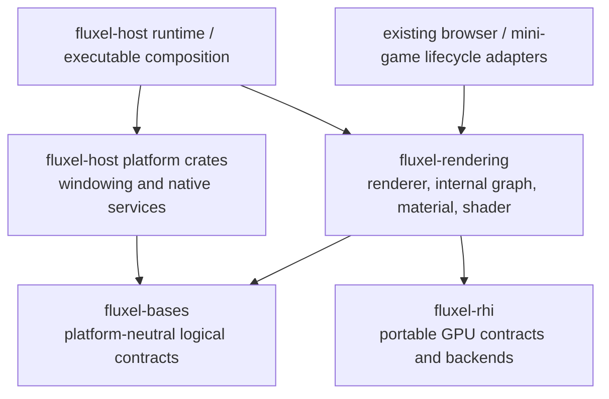
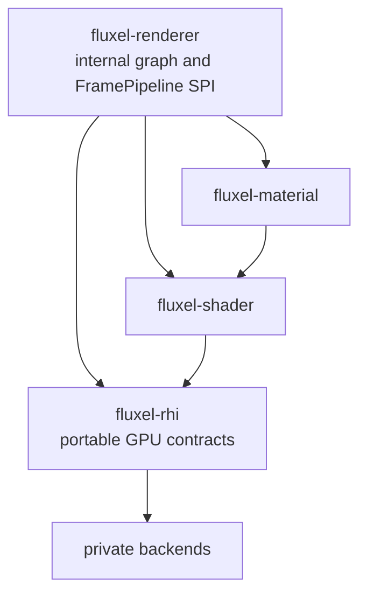

# Fluxel Ecosystem Architecture

This document assigns repository and crate ownership. It does not define API
semantics, plan order, or delivery status; those belong to the owning contracts
and [ROADMAP.md](ROADMAP.md).

Fluxel has four monorepositories: `fluxel-bases`, `fluxel-rendering`,
`fluxel-host`, and `fluxel-jsbridge`, plus the independent
[`fluxel-rhi`](https://github.com/fluxel-project/fluxel-rhi) repository.

## Repository dependency direction



`fluxel-bases` is the dependency leaf. `fluxel-rendering` does not import host
or browser-lifecycle adapters. Reusable host platform crates do not import
rendering; only host runtime composition may combine them. Existing browser and
mini-game integrations adapt platform lifecycle and do not become a semantic
authority.

## Rendering ownership

### Frame execution

```text
External scene adapters
    -> RenderScene snapshots + typed RenderFeature data
    -> FramePipeline policy + Feature-local preparation
    -> Renderer-internal RenderGraph
    -> fluxel-rhi
    -> private backend realization
```

`FramePipeline` decides phases, targets, and frame composition. RenderFeatures
contribute batch data and declared work, using local geometry, visibility,
ordering, batching, or deformation algorithms selected by their consumer. The
renderer-internal RenderGraph validates and schedules the resulting pass/resource
work. It does not know PBR, terrain, water, object sorting, or other renderer
algorithms.

Renderer accepts ordinary Rust crate extensions, not a mandatory ECS, one global
culling/sorting service, a fixed vertex struct, or per-object virtual calls.
Typed CPU batches and declared GPU products are distinct preparation results.
The phase policy owns composition across Feature contributions, including any
transparent ordering or explicit compositing rule. All frame GPU work remains
Graph work; extensions do not acquire an independent submission path or scheduler.
Renderer-controlled uploads follow the explicit preparation boundary below.
An algorithm-specific trait normally belongs to the Feature or external crate
that owns its data. Renderer Core fixes only the cross-Feature protocols that
need common snapshot, identity, phase/Graph contribution, resource-access, or
lifecycle semantics. Several consumers do not automatically promote an
algorithm-specific trait into Core.
All Rendering extension contracts use Rust generics, traits and monomorphization
exclusively, including setup. Applications assemble concrete pipelines and typed
Feature sets at compile time. No `dyn Trait`, trait-object registry or runtime
type erasure is permitted. Runtime enablement uses ordinary state; required
implementation switching uses explicit enum branches over compiled types.
This excludes loading unknown Feature types at runtime, while scene contents,
resource descriptors and Graph topology remain runtime data.

### Material compilation

```text
MaterialGraph -> Material IR -> generic WGSL source units + interface metadata
    -> renderer-selected template and entry points -> ShaderCompositionRequest
    -> Shader composition / logical reflection -> RHI route and native lowering
```

`fluxel-material` owns material function definitions/references, parameters and
uniform schemas, call composition, and evaluation-code generation. It lowers its
private IR to Shader-owned generic source/interface vocabulary; it neither knows
which pipeline will consume the material nor constructs the final request.
FramePipeline/renderer adds the pass template, entry points, geometry interface,
target facts, and static inputs. `fluxel-shader` owns complete logical program
assembly, source validation/reflection, logical artifacts, variants, and cache
identity; it never depends on Material or receives MaterialIr. RHI owns the
opened-device route, ABI facts, backend Naga/native lowering, native compilation,
and executable pipeline validation. Both Material and Shader are independent
`fluxel-rendering` crates; Shader remains available to compute, particles, and
post processing.

### Crate and portable-contract dependencies



The former standalone `fluxel-rendergraph` crate has been removed. Its rebuilt
semantics live in the private `fluxel-renderer::graph` module; no future public
RenderGraph crate is planned. The private S0/S1 foundation is implemented and
accepted for the named DX12 and WGL matrix; the
[Rendering closure record](https://github.com/fluxel-project/fluxel-rendering/blob/1085c9e7e8fd50b1cfa58201b1838687263c482e/documents/s0-s1-closure.md)
records exact dependencies, evidence and limits. This foundation does not imply
that later public extension APIs have completed.

`fluxel-rhi` owns portable device facts, physical resources, recording,
submission, completion, presentation, allocation realization, and private
backends. Upper layers use its portable contracts and never reach
backend-private objects or synchronization.

## Library ownership

Existing means an implemented crate or established internal boundary; Target
means an approved architectural destination with migration still required.
Candidate and Unscheduled entries do not authorize implementation on their own.

| Library / boundary | Repository | Status | Ownership |
| --- | --- | --- |
| `fluxel-assets` | `fluxel-bases` | Existing | Logical identity, typed handles, generations, CPU-side state, reuse, and budgets; never GPU residency or source I/O policy |
| `fluxel-base`, `fluxel-diagnostics`, `fluxel-loader`, `fluxel-time`, `fluxel-input` | `fluxel-bases` | Candidate | Shared utilities, diagnostics, loading orchestration, and portable time/input contracts when a vertical slice proves each boundary; source mechanics stay with callers/platform services |
| `fluxel-image` | `fluxel-bases` | Unscheduled | Owned pixel data and portable image codecs |
| [`fluxel-rhi`](https://github.com/fluxel-project/fluxel-rhi) | independent repository | Stable maintenance baseline | Portable GPU resources, shader/pipeline creation, recording, submission, completion, presentation, and backend realization |
| `fluxel-renderer` | `fluxel-rendering` | Existing, under migration | RenderScene/preparation contracts, private Graph, FramePipeline/Feature facade, residency, frame data and rendering integration; local algorithms remain replaceable |
| former `fluxel-rendergraph` | `fluxel-rendering` | Removed migration input | Rebuilt Graph semantics are private to `fluxel-renderer`; no target public crate exists |
| `fluxel-material` | `fluxel-rendering` | Target scaffold | MaterialGraph, typed composition IR, material functions and call-code generation, parameter/uniform schemas, assets and instances; implementation follows consumer gates |
| `fluxel-shader` | `fluxel-rendering` | Target scaffold | Neutral composition request, complete logical programs/modules, source validation/reflection, variants, source artifacts, interfaces, pipeline requirements, and cache identity; implementation follows consumer gates |
| external `RenderFeature` crates | ecosystem consumers | MVP target | Own typed batch data and contribute phase/Graph work through established contracts; they may use different local algorithms in the same frame |
| `fluxel-platform` | `fluxel-host` | Existing internal boundary | Platform lifecycle, windows, display handles, and native-service composition without rendering dependency |
| `fluxel-fs`, `fluxel-storage`, `fluxel-net`, `fluxel-audio`, `fluxel-video`, `fluxel-native-time`, `fluxel-native-input`, `fluxel-diagnostic-sinks` | `fluxel-host` | Unscheduled | Native platform services, extracted only for a demonstrated reusable consumer |
| host runtime / executable composition | `fluxel-host` | Existing internal boundary | Combines platform crates with rendering into native deliverables |
| browser and mini-game lifecycle adapters | `fluxel-jsbridge` | Existing evidence boundary | Canvas/surface lifecycle adaptation, resize, foreground/background, loss/restore, and diagnostics for named proved targets |

## Ownership rules

- Bases owns logical asset identity and CPU-side state. Rendering owns GPU
  realization, renderer-private cache keys derived from selected RHI identity
  facts, last-use tracking, and completion-safe retirement.
- RenderGraph transient resources are not assets. Graph resources use logical
  versions, dependencies, definedness, and lifetime analysis; physical reuse is
  decided from the graph plan and completion evidence.
- FramePipeline is renderer-owned policy exposed through a controlled public
  Rust trait/context facade once consumer evidence establishes it. RenderFeature
  supplies capabilities and declared batch contributions; Graph plans their
  execution. Visibility, geometry, ordering, batching, and deformation are
  Feature/Pipeline-local choices, not mandatory global services. A raster pass can contain draws
  using several graphics pipelines (VS and optional FS); a compute pass uses CS;
  a copy pass needs no shader. Pass identity is independent from shader program
  identity, and Graph implementation internals stay private.
- Feature/Pipeline/provider extension composition uses concrete generic types,
  without trait-object dispatch or runtime type erasure. Tuples, ordinary
  aggregates and necessary associated types suffice as starting mechanisms;
  this does not authorize a general type-level framework.
  Static dispatch is not a blanket zero-cost claim: code size, compile time, and
  workload results remain measured tradeoffs.
- Reflection provides binding usage; preparation resolves concrete resources
  and ranges. Graph validates every bound resource against pass declarations
  before recording and incorporates its access into dependencies and lifetimes.
- RenderScene is a renderer-domain snapshot boundary, not an ECS or gameplay
  hierarchy. External adapters retain identity mappings and submit typed changes.
  SoA, AoS, and AoSoA are workload-local layouts rather than public contracts.
  Geometry is stream/attribute data matched with Shader input requirements by
  preparation; it is not a fixed Mesh vertex type. Animation evaluation remains
  external, while CPU, vertex-stage, or Graph-compute deformation consumes its
  explicit outputs.
- CPU visible batches and GPU-produced visibility/indirect products have separate
  protocols. GPU products declare producer/consumer accesses and retain Graph/RHI
  lifetime authority. Feature-local transparent pre-sorts require a phase-owned
  final merge or explicit compositing strategy.
- Renderer coordinates residency transfers through RHI, exposing producer
  dependencies and incoming states to consuming Graph work and retaining resources
  through completion. An accepted transfer may be usable by its named graph
  consumer through an enforceable dependency before it is globally complete or
  reusable. Per-frame transform, uniform, and bone data has a separate Frame Data
  Upload lifecycle, though it may reuse the same lower upload mechanism. Features
  request uploads rather than submit commands. Frame rendering and compute remain
  Graph work; there is no second frame scheduler.
- Resource ownership follows the selected RHI device identity and lifecycle.
  Cross-device or stale resource use returns a structured error before backend calls.
- Existing browser and mini-game adapters translate canvas/surface lifecycle, resize,
  foreground/background, and loss/restore. WebGPU/WebGL objects and all backend
  leases remain private implementation details.
- Host-to-RHI integration produces opaque RHI presentation targets while the
  host retains its window/display lifetime. RHI owns configuration, acquisition,
  presentation, and GPU synchronization.

The authoritative RHI contract is maintained in `fluxel-rhi`; renderer,
material, shader, and internal graph contracts are maintained in
`fluxel-rendering`. Capture/replay, Canvas 2D/basic text, declarative UI,
Blender tooling, and JavaScript encapsulation are deferred and undecided.

A future engine runtime requires separate planning for Game Scene, TypeScript
gameplay execution, the game loop, Rust/TS bindings, and script hot reload. It
may adapt batched scene changes into RenderScene without making Renderer own
gameplay. This is an unscheduled direction; `fluxel-jsbridge` remains platform
lifecycle adaptation and does not become the gameplay runtime.
