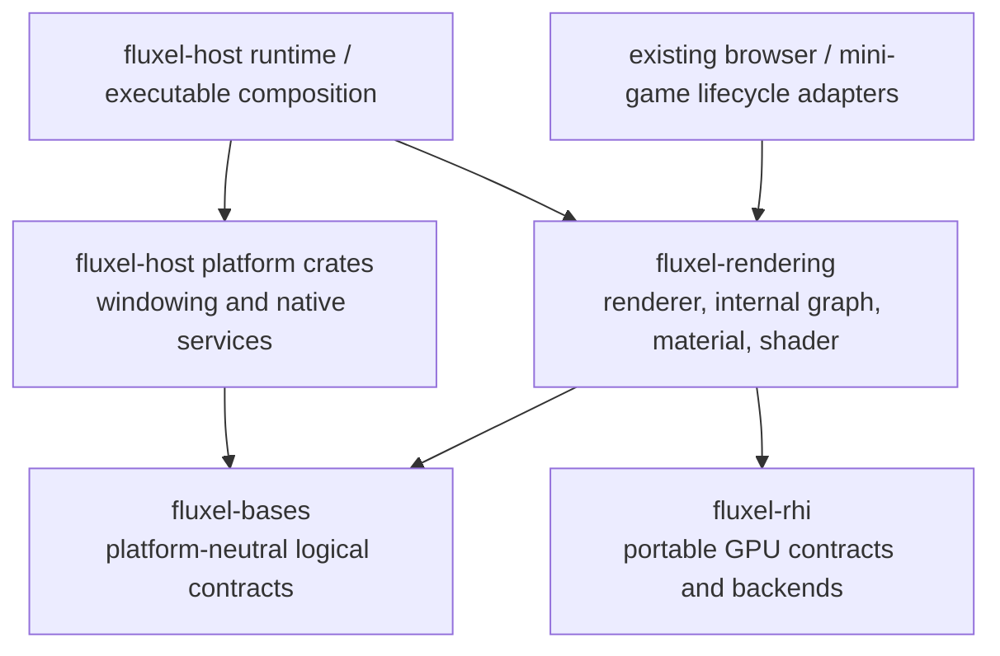
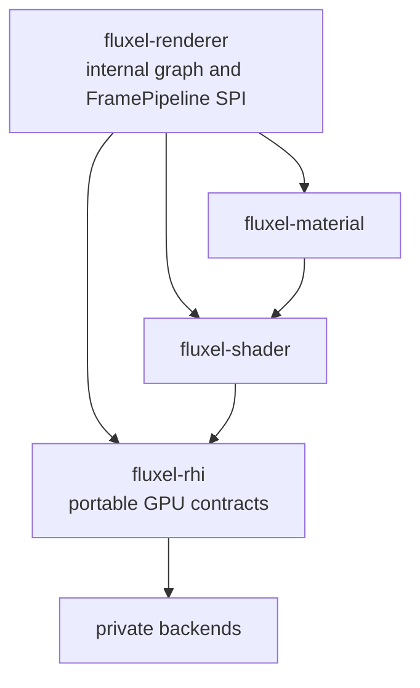

# Fluxel Ecosystem Architecture

This document assigns repository and crate ownership. It does not define API
semantics, plan order, or delivery status; those belong to the owning contracts
and [ROADMAP.md](ROADMAP.md).

Fluxel has four monorepositories: `fluxel-bases`, `fluxel-rendering`,
`fluxel-host`, and `fluxel-jsbridge`, plus the independent
[`fluxel-rhi`](https://github.com/fluxel-project/fluxel-rhi) repository.

## Repository dependency direction



`fluxel-bases` is the dependency leaf. `fluxel-rendering` does not import host
or browser-lifecycle adapters. Reusable host platform crates do not import
rendering; only host runtime composition may combine them. Existing browser and
mini-game integrations adapt platform lifecycle and do not become a semantic
authority.

## Rendering ownership

### Frame execution

```text
RenderScene / RenderView / RenderFeatures
    -> FramePipeline (renderer-owned public Rust extension trait)
    -> Renderer-internal RenderGraph
    -> fluxel-rhi
    -> private backend realization
```

`FramePipeline` decides which frame work is needed. The renderer-internal
RenderGraph validates and schedules pass/resource work. It does not know PBR,
terrain, water, or other renderer algorithms.

### Material compilation

```text
MaterialGraph -> Material IR -> generic WGSL source units + interface metadata
    -> renderer-selected template and entry points -> ShaderCompositionRequest
    -> Shader composition / logical reflection -> RHI route and native lowering
```

`fluxel-material` owns material function definitions/references, parameters and
uniform schemas, call composition, and evaluation-code generation. It lowers its
private IR to Shader-owned generic source/interface vocabulary; it neither knows
which pipeline will consume the material nor constructs the final request.
FramePipeline/renderer adds the pass template, entry points, geometry interface,
target facts, and static inputs. `fluxel-shader` owns complete logical program
assembly, source validation/reflection, logical artifacts, variants, and cache
identity; it never depends on Material or receives MaterialIr. RHI owns the
opened-device route, ABI facts, backend Naga/native lowering, native compilation,
and executable pipeline validation. Both Material and Shader are independent
`fluxel-rendering` crates; Shader remains available to compute, particles, and
post processing.

### Crate and portable-contract dependencies



The existing standalone `fluxel-rendergraph` crate is migration state. Its
graph semantics move into the `fluxel-renderer` internal module; no future
public RenderGraph crate is planned. Old RHI dependency edges are migration
state until their exact integration revisions and consumers are converted. This
describes the target architecture, not a claim that migration has completed.

`fluxel-rhi` owns portable device facts, physical resources, recording,
submission, completion, presentation, allocation realization, and private
backends. Upper layers use its portable contracts and never reach
backend-private objects or synchronization.

## Library ownership

Existing means an implemented crate or established internal boundary; Target
means an approved architectural destination with migration still required.
Candidate and Unscheduled entries do not authorize implementation on their own.

| Library / boundary | Repository | Status | Ownership |
| --- | --- | --- |
| `fluxel-assets` | `fluxel-bases` | Existing | Logical identity, typed handles, generations, CPU-side state, reuse, and budgets; never GPU residency or source I/O policy |
| `fluxel-base`, `fluxel-diagnostics`, `fluxel-loader`, `fluxel-time`, `fluxel-input` | `fluxel-bases` | Candidate | Shared utilities, diagnostics, loading orchestration, and portable time/input contracts when a vertical slice proves each boundary; source mechanics stay with callers/platform services |
| `fluxel-image` | `fluxel-bases` | Unscheduled | Owned pixel data and portable image codecs |
| [`fluxel-rhi`](https://github.com/fluxel-project/fluxel-rhi) | independent repository | Stable maintenance baseline | Portable GPU resources, shader/pipeline creation, recording, submission, completion, presentation, and backend realization |
| `fluxel-renderer` | `fluxel-rendering` | Existing, under migration | RenderScene preparation, internal RenderGraph, FramePipeline SPI, visibility, draw preparation, residency, and rendering integration |
| `fluxel-rendergraph` | `fluxel-rendering` | Migration state | Existing standalone crate whose semantics migrate into `fluxel-renderer`; not a target public crate |
| `fluxel-material` | `fluxel-rendering` | Target crate | MaterialGraph, typed composition IR, material functions and call-code generation, parameter/uniform schemas, assets and instances |
| `fluxel-shader` | `fluxel-rendering` | Target crate | Neutral composition request, complete logical programs/modules, source validation/reflection, variants, source artifacts, interfaces, pipeline requirements, and cache identity; RHI owns device-route and native compilation |
| external `RenderFeature` crates | ecosystem consumers | MVP target | Prepare data, incrementally join batches, and declare renderer graph resources/passes through established contracts |
| `fluxel-platform` | `fluxel-host` | Existing internal boundary | Platform lifecycle, windows, display handles, and native-service composition without rendering dependency |
| `fluxel-fs`, `fluxel-storage`, `fluxel-net`, `fluxel-audio`, `fluxel-video`, `fluxel-native-time`, `fluxel-native-input`, `fluxel-diagnostic-sinks` | `fluxel-host` | Unscheduled | Native platform services, extracted only for a demonstrated reusable consumer |
| host runtime / executable composition | `fluxel-host` | Existing internal boundary | Combines platform crates with rendering into native deliverables |
| browser and mini-game lifecycle adapters | `fluxel-jsbridge` | Existing evidence boundary | Canvas/surface lifecycle adaptation, resize, foreground/background, loss/restore, and diagnostics for named proved targets |

## Ownership rules

- Bases owns logical asset identity and CPU-side state. Rendering owns GPU
  realization, renderer-private cache keys derived from selected RHI identity
  facts, last-use tracking, and completion-safe retirement.
- RenderGraph transient resources are not assets. Graph resources use logical
  versions, dependencies, definedness, and lifetime analysis; physical reuse is
  decided from the graph plan and completion evidence.
- FramePipeline is renderer-owned policy exposed through a controlled public
  Rust trait/context facade. RenderFeature supplies capabilities and declared
  contributions; Graph plans their execution. A raster pass can contain draws
  using several graphics pipelines (VS and optional FS); a compute pass uses CS;
  a copy pass needs no shader. Pass identity is independent from shader program
  identity, and Graph implementation internals stay private.
- Reflection provides binding usage; preparation resolves concrete resources
  and ranges. Graph validates every bound resource against pass declarations
  before recording and incorporates its access into dependencies and lifetimes.
- Renderer coordinates residency transfers through RHI, exposing producer
  dependencies and incoming states to consuming Graph work and retaining resources
  through completion. An accepted transfer may be usable by its named graph
  consumer through an enforceable dependency before it is globally complete or
  reusable. Per-frame transform, uniform, and bone data has a separate Frame Data
  Upload lifecycle, though it may reuse the same lower upload mechanism. Features
  request uploads rather than submit commands. Frame rendering and compute remain
  Graph work; there is no second frame scheduler.
- Resource ownership follows the selected RHI device identity and lifecycle.
  Cross-device or stale resource use returns a structured error before backend calls.
- Existing browser and mini-game adapters translate canvas/surface lifecycle, resize,
  foreground/background, and loss/restore. WebGPU/WebGL objects and all backend
  leases remain private implementation details.
- Host-to-RHI integration produces opaque RHI presentation targets while the
  host retains its window/display lifetime. RHI owns configuration, acquisition,
  presentation, and GPU synchronization.

The authoritative RHI contract is maintained in `fluxel-rhi`; renderer,
material, shader, and internal graph contracts are maintained in
`fluxel-rendering`. Capture/replay, Canvas 2D/basic text, declarative UI,
Blender tooling, and JavaScript encapsulation are deferred and undecided.

A future engine runtime requires separate planning for Game Scene, TypeScript
gameplay execution, the game loop, Rust/TS bindings, and script hot reload. It
may adapt batched scene changes into RenderScene without making Renderer own
gameplay. This is an unscheduled direction; `fluxel-jsbridge` remains platform
lifecycle adaptation and does not become the gameplay runtime.
